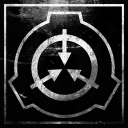

# SCP - Containment Breach for Wii U



A native port of SCP - Containment Breach (v1.3.11) to the Wii U, for the Aroma homebrew environment.

The game's original BlitzBasic source code is translated to C++ ahead of time and runs on a re-implementation
of the Blitz3D engine, based on Blitz3D's open-source code. Rendering uses the Wii U's GPU directly.

**Everything is included.** SCP - Containment Breach is free and licensed under Creative Commons, so the game's
files come with the port. You don't need anything else.

## Status

Playable on a real Wii U. The start of the game runs at 55-60 FPS. A full playthrough hasn't been tested yet,
so later areas may still have bugs. If you find one, please open an issue (see [Reporting a problem](#reporting-a-problem)).

## Features

 - The full game (v1.3.11), with its own icon and boot screens on the Wii U Menu
 - Hardware rendering on the Wii U's GPU, 1280x720, on the TV and the GamePad at the same time (Off-TV play works)
 - Full GamePad controls, including the touch screen for menus, the inventory and keypads, and drag-to-look
 - Wii U Pro Controller support, with the same button layout
 - The in-game HUD (meters, inventory, documents, messages) drawn larger on the GamePad, while the TV keeps the
   normal size
 - Bigger main and pause menus, readable on the GamePad
 - Music, sound effects and voices
 - On-screen keyboard (GamePad keyboard) for naming saves and for the console
 - Saving and loading, quick save on − (Select)

## Controls (Wii U GamePad and Pro Controller)

| Button | Action |
|---|---|
| Left stick / right stick | Move / look |
| A / ZR | Interact, pick up, use (left click) |
| Y | Right click |
| ZL | Blink |
| L | Crouch |
| B / L3 (click left stick) | Sprint (hold) |
| X | Inventory |
| + | Pause menu |
| − | Quick save |
| R | Console (when enabled in Options → Advanced) |
| D-pad | Arrow keys |
| R3 (click right stick) | Performance overlay on / off |

 - **Touch screen** (GamePad only): when the game shows a pointer (menus, inventory, keypads), touch where you
   want to click; double tap an item in the inventory to use it. During gameplay, drag to look around and tap
   to interact.
 - **Pro Controller:** same buttons, without the touch screen. It works together with the GamePad.
 - The controls are listed in the game under Options → Controls.

## Installing

Requires a Wii U with [Aroma](https://aroma.foryour.cafe/) installed. If you don't know how to mod your Wii U, [use this guide](https://wiiu.hacks.guide/)​.

1. Download the latest release from the [Releases page](https://github.com/NanoBunTV/Wii-U-SCPCB/releases/latest).
2. Copy the `wiiu` folder to the root of your SD card (about 375 MB).
3. Start SCP - Containment Breach from the Wii U Menu.

Saves, settings and the log are stored in `sd:/wiiu/apps/scpcb/`.

## Known limitations

 - Starting a new game takes about 20 seconds (the SD card is slow).
 - No intro video.
 - Custom maps ("Load map") and the map creator aren't available.
 - The console is off by default; turn it on in Options → Advanced.

## Reporting a problem

The game writes a log to `sd:/wiiu/apps/scpcb/log.txt` every time it starts. Attach that file to your issue,
with where you were in the game and what happened. If the game crashes, it shows a crash screen: a photo of
it helps too. For slowdowns, a photo with the performance overlay on (click the right stick) shows where the
time goes.

## Credits

 - [SCP - Containment Breach](https://www.scpcbgame.com/) by Joonas Rikkonen ("Regalis") / Undertow Games and
   all the contributors listed in the game's credits - the game, its
   [source code](https://github.com/Regalis11/scpcb) and its assets.
 - The [SCP Foundation](https://scp-wiki.wikidot.com/) community - the works the game is based on.
 - [Blitz3D](https://github.com/blitz-research/blitz3d) by Blitz Research (Mark Sibly) - the engine and compiler
   whose open-source code this port's runtime and translator are built on.
 - [B3DDecomp](https://github.com/juanjp600/B3DDecomp) by Juan Pablo Arce - used to check the source against the
   released game.
 - [devkitPro](https://devkitpro.org/) and [wut](https://github.com/devkitPro/wut) - the toolchain and platform
   libraries.
 - [Aroma](https://aroma.foryour.cafe/) by Maschell - the homebrew environment.
 - [CafeGLSL](https://github.com/Exzap/CafeGLSL) by Exzap - used to build the GPU shaders.
 - [Cemu](https://cemu.info/) - used for testing during development.
 - Claude - AI assistance.

## License

This port is licensed under the Creative Commons Attribution-ShareAlike 3.0 License, like the game it is based
on. Refer to the provided [LICENSE.md](LICENSE.md) file for further information. The engine runtime
(`runtime/`) and the BlitzBasic-to-C++ translator (`tools/bb2cpp/`) are based on Blitz3D and stay under its
zlib/libpng License ([runtime/BLITZ3D_LICENSE.txt](runtime/BLITZ3D_LICENSE.txt)). The port's changes to the
game's source are in [`game/src/`](game/src/), marked with `;Wii U port:` comments.

## Third-party licenses

### [SCP - Containment Breach](https://github.com/Regalis11/scpcb)
by Undertow Games and contributors under Creative Commons Attribution-ShareAlike 3.0 (game code and assets)
### [Blitz3D](https://github.com/blitz-research/blitz3d)
by Blitz Research Ltd under zlib/libpng License
### [wut](https://github.com/devkitPro/wut)
by devkitPro under zlib License
### [stb_image, stb_truetype, stb_vorbis, stb_dxt](https://github.com/nothings/stb)
by Sean Barrett and contributors under MIT License / Public Domain
### [Zstandard](https://github.com/facebook/zstd)
by Meta Platforms, Inc. and affiliates under BSD License

This project is not affiliated with or endorsed by Undertow Games or Nintendo.

## Building

Requires [devkitPro](https://devkitpro.org/wiki/Getting_Started) with the Wii U packages, MSYS2 with MinGW-w64
g++ (for the PC tools, expected at `C:\msys64\mingw64`), Python 3 and PowerShell 7.

1. Install the Wii U packages from devkitPro's MSYS2 shell:
   ```
   pacman -S --needed wiiu-dev wiiu-cmake ppc-zstd
   ```
2. Get the game's assets and the shader compiler (not in git):
   - Download the [SCP - Containment Breach v1.3.11 release](https://undertowgames.com/file/scp/SCP%20-%20Containment%20Breach%20v1.3.11.zip)
     and unzip it to `_ref/game/`.
   - Download [CafeGLSL](https://github.com/Exzap/CafeGLSL/releases) (v1.0.0-rc1, Windows x86_64) and extract it
     so that `bin/` is directly under `_ref/tools/cafeglsl/`.
3. Build the PC tools (the BlitzBasic-to-C++ translator and the texture compressor):
   ```
   tools/bb2cpp/build.sh
   tools/texconv/build.sh
   ```
4. Build:
   ```
   .\build.ps1
   ```
   This produces `build\scpcb_game.wuhb`.

[Full build instructions and developer notes](Docs/BUILDING.md) · [Developer documentation](Docs/README.md)
